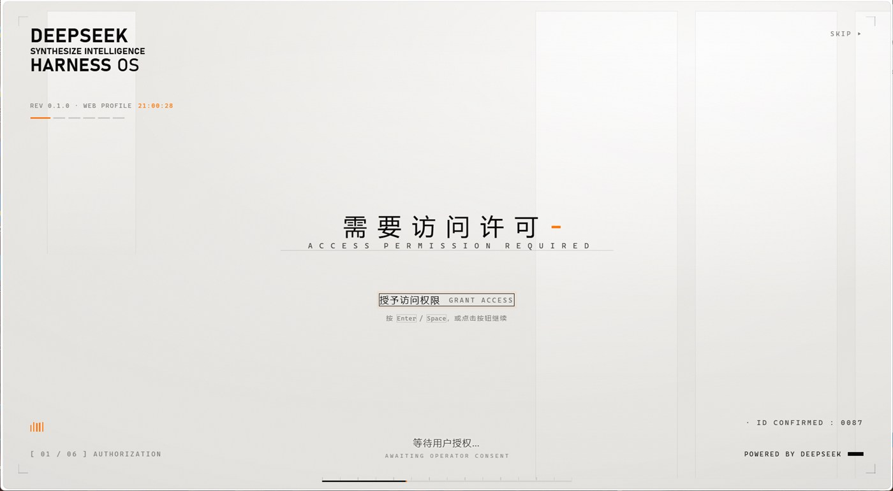

# EXILE 启动界面 · dsh-startup-exile

> DeepSeek Harness 的启动动画：黑幕 EXILE 标识 → 过曝洗白 → 暖白档案底板 → 五步交互授权 → 色散揭幕。
> 背景是一层绿色二进制数字雨，文字压在最上层。



---

## 关于原创

这是**二次创作**，基于 [6shenhonghong9/dsh-startup-screen](https://github.com/6shenhonghong9/dsh-startup-screen) v1.3.0（MIT，作者：沈宏宏）。

本仓库从原版发布包原样复制，**只改了下面这四处内容**，启动结构、设置页、语音音效系统全部保留原样：

| 改动 | 内容 |
|---|---|
| 标识 | 黑幕与 logo 舞台的 DeepSeek 鲸鱼 SVG → EXILE 圆形电路标识（透明 PNG） |
| 文案 | 第一幕：`EXILE` / `不止AI，步入生活，改变生活` / `MORE THAN AI` · `STEP INTO LIFE` |
| 第二幕左上角 | `AI不止于现在更能改变未来` + `AI IS MORE THAN NOW. IT CHANGES THE FUTURE.`（进配置，带内置兜底） |
| 背景 | 绿色二进制数字雨（1920×1080，8 秒循环，CRT 扫描线 / 噪点 / 拖影），置于最底层 |

所有功劳属于原作者。原作者若要求撤下，本仓库会立即删除。

---

## 安装

```powershell
# 本地 link 安装
dsh plugin --profile web add link:<本仓库路径>
```

或手动：把目录拷到 `~/.dsh/profiles/desktop/node_modules/dsh-startup-exile`，在 profile 的
`package.json` 里把 `"dsh-startup-exile": "1.3.0-exile"` 加进 `dependencies`，并把
`dsh-startup-exile` 追加到 `dsh.profile.bundles`，然后完全退出 DSH 重开。

**包名和原版不同**（`dsh-startup-exile` vs `dsh-startup-screen`），两者可以共存，不会互相覆盖。

## 想改文案

打开 `~/.dsh/dsh-startup.json`：

```json
{
  "cornerZh": "AI不止于现在更能改变未来",
  "cornerEn": "AI IS MORE THAN NOW. IT CHANGES THE FUTURE.",
  "brand1": "EXILE",
  "brand2": "不止AI，步入生活，改变生活"
}
```

改完保存，刷新页面即生效。字段缺失或为空时，会退回代码里的内置兜底文案。

## 预览

```powershell
python -m http.server 8777 --directory .
# 打开 http://127.0.0.1:8777/preview/index.html
```

## 许可

MIT。`LICENSE` 保留原作者 Copyright (c) 2026 沈宏宏，并附加二创声明。
