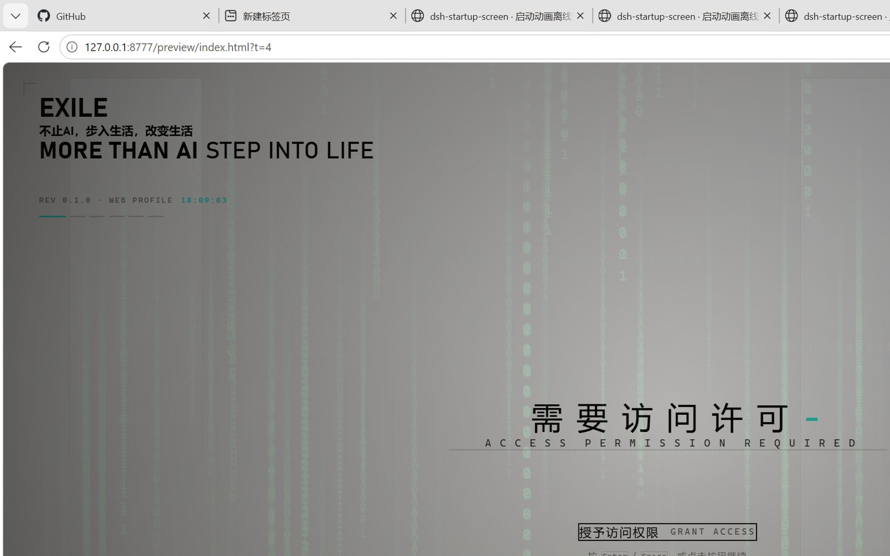
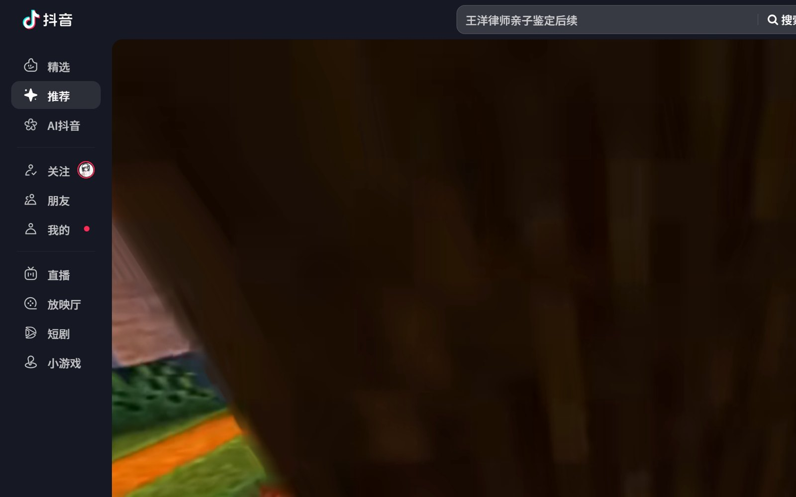

# EXILE Startup Screen · DSH 启动动画（二创）

> DeepSeek Harness 的启动界面：黑幕 EXILE 标识 → 过曝洗白 → 暖白档案底板 → 五步交互授权 → 色散揭幕。
> 背景是绿色二进制数字雨（纵向为主、后段横向穿插），整段带 CRT 扫描线与拖影。





---

## ⚠️ 关于原创（请先读这段）

这是一个**二次创作**，不是从零写的：

| | |
|---|---|
| **原作** | [6shenhonghong9/dsh-startup-screen](https://github.com/6shenhonghong9/dsh-startup-screen) |
| **原作者** | 沈宏宏（@6shenhonghong9） |
| **原作版本** | v1.3.0 |
| **原作许可** | MIT |
| **本仓库许可** | 同样 MIT，保留原作者版权声明 |

**所有功劳属于原作者。** 动画的时间线、五步授权序列、玻璃底板、语音与音效系统、设置页框架全部来自原作；本仓库只做了下面列的这几处改动。原作者如果要求撤下，这个仓库会立刻删除或改成引用。

---

## 本版改了什么

### 1. 标识

- 黑幕与 logo 舞台上的 DeepSeek 鲸鱼 SVG → EXILE 圆形电路标识（`lib/assets/logo.png`，透明底）
- 品牌区文案：`EXILE` / `不止AI，步入生活，改变生活` / `MORE THAN AI` · `STEP INTO LIFE`
- 页脚：`MORE THAN AI · BUILDING TOMORROW`

### 2. 第二幕左上角提示（新增）

第二幕「身份资料确认」出现时，左侧显示：

```
┌─ AI不止于现在更能改变未来
│  AI IS MORE THAN NOW. IT CHANGES THE FUTURE.
```

带一条青色竖线做视觉锚点，其余幕自动收起。原作这一幕的内容一字未动。

### 3. 背景数字雨（新增）

`lib/assets/rain.mp4`，1920×1080 / 30fps / 8 秒循环，由 `tools/make_rain.py` 逐帧渲染：

- 纯黑底，只有绿色「0」「1」，三层深度（前景亮、中景半透明、远景细密）
- 前 42% 只有纵向流；之后横向数据流从左往右穿插，密度刻意做稀
- CRT 质感：每 3 像素压暗一行的扫描线、像素噪点、轻微闪烁、暗角、数字拖影
- 黑幕阶段全亮播放，白底板上场后降到 16% 当隐约背景

### 4. 配色

强调色 `#ff7500`（橙）→ `#2fe0d0`（青绿），glitch 双色同步调整。

### 5. 资源路由

原作的 `/dsh-startup/asset` 只放行 `.mp3`；本版放开 `png / mp4 / webm / jpg` 并按扩展名给 Content-Type，否则 logo 和视频取不到。

---

## 安装

```powershell
# 作为本地插件挂进你的 profile
dsh plugin --profile web add link:<本仓库路径>
```

或手动：

1. 把整个目录拷到 `~/.dsh/profiles/desktop/node_modules/dsh-startup-screen-exile`
2. 在 `~/.dsh/profiles/desktop/package.json` 的 `dependencies` 里加
   `"dsh-startup-screen-exile": "1.3.0-exile.1"`
3. 在同文件的 `dsh.profile.bundles` 数组末尾加 `"dsh-startup-screen-exile"`
4. 完全退出 DSH 再打开

> 包名和原作不同，**可以和官方版共存**，不会互相覆盖。

## 预览（不用安装）

```powershell
python -m http.server 8777 --directory .
# 浏览器打开 http://127.0.0.1:8777/preview/index.html
```

## 想自己改

| 想改什么 | 改哪里 |
|---|---|
| 第二幕那行字 | `lib/splash.js` 里搜「AI不止于现在」 |
| 品牌文案 / 强调色 | `lib/splash.js` 的 `DEFAULTS` 对象 |
| 六幕台词与时长 | `lib/splash.js` 的 `STEPS` 数组 |
| 数字雨参数（密度、速度、颜色） | `tools/make_rain.py` 顶部的层定义与 `fluo` 颜色 |
| 重新渲染视频 | `python tools/make_rain.py binary_rain.mp4`，再拷进 `lib/assets/rain.mp4` |

---

## 许可

MIT。`LICENSE` 里同时保留了原作者与本仓库的版权声明。

原作：Copyright (c) 2026 沈宏宏
二创：Copyright (c) 2026 exile412
